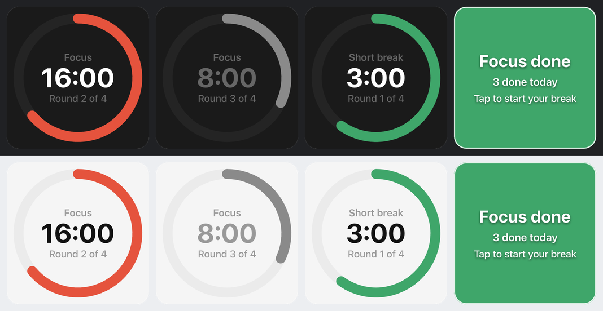

<p align="center">
  
</p>

<h1 align="center">Pomodoro for Macro Deck</h1>

<p align="center">
  A focus timer widget for <a href="https://macro-deck.app">Macro Deck 3</a>: focus, short break, long break, repeat.
</p>

<p align="center">
  <a href="https://github.com/ashrafabulsoud/macro-deck-pomodoro/releases"><b>Download</b></a>
  &nbsp;·&nbsp;
  <a href="https://github.com/ashrafabulsoud/macro-deck-pomodoro/issues/new?template=feedback.yml"><b>Share feedback</b></a>
  &nbsp;·&nbsp;
  <a href="https://github.com/ashrafabulsoud/macro-deck-pomodoro/issues/new?template=bug_report.yml"><b>Report a bug</b></a>
  &nbsp;·&nbsp;
  <a href="https://github.com/ashrafabulsoud/macro-deck-pomodoro/issues/new?template=feature_request.yml"><b>Suggest an idea</b></a>
</p>



> **Testers wanted.** This is an early version that is not in the Macro Deck Store yet. Install it, use it
> for a few days, and tell me how it went. See [Giving feedback](#giving-feedback).

## Contents

- [What it does](#what-it-does)
- [Install](#install)
- [Quick start](#quick-start)
- [Reading the tile](#reading-the-tile)
- [Settings](#settings)
- [Automations: Focus mode, sounds and more](#automations-focus-mode-sounds-and-more)
- [Troubleshooting](#troubleshooting)
- [Known limitations](#known-limitations)
- [Giving feedback](#giving-feedback)
- [Privacy](#privacy)
- [For developers](#for-developers)

## What it does

The [Pomodoro method](https://en.wikipedia.org/wiki/Pomodoro_Technique) splits work into short focus
sessions with breaks in between: 25 minutes of focus, a 5 minute break, and after four rounds a longer
15 minute break. This plugin puts that timer on your deck.

- **One tile** shows the phase, the time left, a ring that empties as time runs out, and the round you are in.
- **Tap** to start, pause and resume. **Long press** to start over from the first round.
- **At the end of a phase** the tile turns the color of what comes next and pulses until you tap it, or
  moves on by itself if you turn on auto-start.
- **Counts the pomodoros** you finished today.
- **Raises events** when a phase starts or ends, so you can switch on macOS Focus, play a sound or dim a
  light automatically.
- **Optional desktop notification** at the end of every phase.
- **Survives restarts** of the plugin and of Macro Deck.

## Install

You need **Macro Deck 3** on Windows (x64), macOS (Apple silicon) or Linux (x64).

1. Download `com.ashrafabulsoud.pomodoro-<version>.macroDeckPlugin` from the
   [latest release](https://github.com/ashrafabulsoud/macro-deck-pomodoro/releases).
2. In Macro Deck, install it from the file (open the plugins page and choose to install a plugin from a
   file, or double-click the downloaded file if `.macroDeckPlugin` files open with Macro Deck).
3. Macro Deck warns that the plugin is **not signed**. That is expected for a test version that does not come
   from the Store yet: confirm to install it.

To update, install the newer file the same way. Your widgets and their settings stay as they are.

## Quick start

1. Open a folder in Macro Deck and add a widget. Pick **Pomodoro**.
2. Tap the tile. The ring starts to empty and the time counts down from 25:00.
3. Want to see the whole cycle quickly? Edit the widget, set **Focus** to 1 minute and **Short break** to
   1 minute, and watch a round go by.

| Gesture | What it does |
| --- | --- |
| Tap | Start, pause, resume. At the end of a phase: start the next one. |
| Long press | Go back to the first focus round, not started. Today's count is kept. |

## Reading the tile

| The tile shows | Meaning |
| --- | --- |
| Red ring, **Focus** | Focus session. The ring uses your accent color if you set one. |
| Green ring, **Short break** or **Long break** | Break time. |
| Grey ring, dimmed time | Paused. Tap to continue. |
| Full ring that does not move | Ready to start. Tap to begin. |
| **Round 2 of 4** | Which focus round of the cycle you are in. After the last one comes the long break. |
| Solid green tile, **Focus done**, pulsing | A focus session ended. Shows how many you did today. Tap to start the break. |
| Solid red tile, **Break over**, pulsing | A break ended. Tap to focus again. |

## Settings

Edit the widget to change these. Every widget has its own settings, so you can have a 50/10 tile next to a
25/5 one.

| Setting | Default | Range |
| --- | --- | --- |
| Focus (minutes) | 25 | 1 to 180 |
| Short break (minutes) | 5 | 1 to 180 |
| Long break (minutes) | 15 | 1 to 180 |
| Focus rounds before a long break | 4 | 1 to 12 |
| Start the next phase automatically | Off | |
| Show a desktop notification when a phase ends | Off | |

The usual appearance settings work too: background color (including transparent), accent color, label and
border. The **label** appears under the countdown and is sent with every event, which is how you tell
several Pomodoro widgets apart in automations.

Changing a duration while a phase is running keeps the time you already spent. If the new length is shorter
than that, the phase ends right away.

## Automations: Focus mode, sounds and more

The plugin adds three events to Macro Deck's trigger editor, under **Pomodoro**:

| Event | When | Values you can use in the flow |
| --- | --- | --- |
| **Pomodoro phase started** | A focus session or break starts | `phase` (`focus`, `short-break`, `long-break`), `round`, `label`, `widgetId` |
| **Pomodoro phase finished** | A focus session or break runs out (not when you reset) | same as above |
| **Pomodoro completed** | A focus session runs to the end | `completedToday`, `label`, `widgetId` |

On a trigger you can narrow an event to one **Phase** and to one **Widget label**. Leave them empty to react
to everything.

### Guide: turn on macOS Focus while you focus

Macro Deck cannot switch Focus modes by itself, but it can run a Shortcut:

1. Open the **Shortcuts** app and make two shortcuts using the **Set Focus** action:
   `Focus On` (turn Do Not Disturb on) and `Focus Off` (turn it off).
2. In Macro Deck, add a trigger on **Pomodoro phase started** with **Phase** set to **Focus**, and give it the
   **Run Command** action with:
   ```
   shortcuts run "Focus On"
   ```
3. Add a trigger on **Pomodoro phase started** with **Phase** set to **Short break** that runs
   `shortcuts run "Focus Off"`, and one more for **Long break**.

On Windows, use the same idea with a script or tool that toggles Focus Assist.

### More ideas

- **Play a sound** when a break starts, with an action that plays a sound file.
- **Change a light**: red while focusing, green on breaks.
- **Post your status** to a chat tool when a focus session starts.
- **Count your day**: use `completedToday` from **Pomodoro completed** in a notification or a variable.

## Troubleshooting

| Problem | What to try |
| --- | --- |
| Pomodoro is not in the widget picker | Make sure the plugin is installed and enabled on Macro Deck's plugins page, then reopen the picker. |
| The tile on my hardware deck shows no time | Expected: hardware decks show a widget's label and colors only. Use the desktop app, web client or Companion app to see the countdown. |
| I turned on notifications but see none | Check that your operating system allows notifications from Macro Deck and that no Focus mode is hiding them. On Linux, `notify-send` must be installed. |
| My automation fires for the wrong tile | Give each widget a label and fill in **Widget label** on the trigger. |
| The timer was further along than expected after my computer slept | The timer keeps running while the computer sleeps, like a kitchen timer would. See the next section. |

Still stuck? [Open a bug report](https://github.com/ashrafabulsoud/macro-deck-pomodoro/issues/new?template=bug_report.yml).

## Known limitations

- **Hardware decks** show the label and colors, not the live countdown.
- **Time passes while you are away.** If a phase runs out while the computer sleeps or Macro Deck is closed,
  the tile shows the right phase when you come back, but no events fire for what you missed. The focus
  session that was running when you left still counts; focus sessions that auto-started while you were away
  do not. With auto-start on, the phase that is running when you return fires **Pomodoro phase started** so
  your automations catch up.
- **Edited settings** reach the timer the next time the widget is shown on a screen.
- **The daily count is per widget** and starts over at local midnight.
- **There is no skip button.** Let the phase run out, or long press to start over.
- **Desktop notifications are best effort**: your operating system decides whether to show them.

## Giving feedback

This version is for testing, and your experience is what decides what changes next.

| I want to... | Use |
| --- | --- |
| Tell you how it works for me | [**Share feedback**](https://github.com/ashrafabulsoud/macro-deck-pomodoro/issues/new?template=feedback.yml) |
| Report something broken | [**Report a bug**](https://github.com/ashrafabulsoud/macro-deck-pomodoro/issues/new?template=bug_report.yml) |
| Ask for a feature | [**Suggest an idea**](https://github.com/ashrafabulsoud/macro-deck-pomodoro/issues/new?template=feature_request.yml) |
| See what others reported | [**All issues**](https://github.com/ashrafabulsoud/macro-deck-pomodoro/issues) |

You need a free GitHub account to open an issue. Each link opens a short form.

**A good bug report includes:**

1. **What you did**, step by step, starting from a fresh tile if you can.
2. **What you expected** and **what happened instead**.
3. **Versions**: the plugin version, the Macro Deck version and your operating system.
4. **Your widget settings** if you changed them.
5. **A screenshot or short screen recording.** Drag it into the issue form.
6. **Log lines**: open Macro Deck's log viewer, look for lines that mention *Pomodoro*, and paste them.

Before opening a new issue, take a quick look at the [existing ones](https://github.com/ashrafabulsoud/macro-deck-pomodoro/issues).
If yours is already there, add a comment or a thumbs-up instead. That tells me how many people it affects.

## Privacy

The plugin makes no network connections and collects nothing. Timer state is saved as a small file in the
plugin's own folder inside Macro Deck's data directory. Desktop notifications go through Macro Deck to your
operating system.

## For developers

Built with the Macro Deck 3 plugin SDK (`3.0.0-beta.19`, pinned in `Directory.Packages.props`). You need the
.NET 10 SDK and the plugin CLI at the same version:

```bash
dotnet tool install --global MacroDeck.Plugin.Cli --version 3.0.0-beta.19
dotnet build -c Release -warnaserror
dotnet test -c Release
macrodeck-plugin test --project src/Pomodoro
macrodeck-plugin preview render --project src/Pomodoro --cells 1x1 --cells 2x2 --output /tmp/pomodoro-previews
macrodeck-plugin build --source src/Pomodoro --output ./artifacts
```

To run it against your own Macro Deck while you work on it, turn on Developer Mode in Macro Deck, run
`macrodeck-plugin run --project src/Pomodoro`, and approve the pairing request. A plugin started this way has
no storage, so its timers do not survive a restart.

Code layout and the rules the code follows are in [AGENTS.md](AGENTS.md). Pull requests are welcome; please
open an issue first for anything larger than a small fix.

## License

MIT, see [LICENSE](LICENSE). Bundled third-party components are listed in
[THIRD-PARTY-NOTICES](THIRD-PARTY-NOTICES). The plugin icon was created with AI assistance, as declared in the
plugin manifest.
